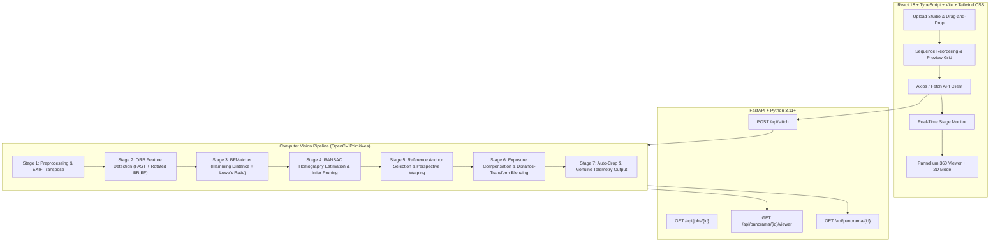

# BORING 360 — AI-Assisted Image Stitching & Interactive Panorama Platform

> **Capture Reality. Experience Everywhere.**
> Genuine Computer Vision Panorama Generation from 8–12 Smartphone Photographs.

Boring 360 is a computer vision web platform that stitches 8–12 overlapping smartphone photographs into a panoramic image and renders the result in an interactive 360-degree viewer powered by Pannellum.

Unlike mockups or applications that call opaque black-box APIs, Boring 360 implements the complete image stitching pipeline from scratch using OpenCV primitives:
**ORB Feature Detection $\rightarrow$ BFMatcher (Hamming Distance) $\rightarrow$ RANSAC Homography Estimation $\rightarrow$ Perspective Warping $\rightarrow$ Distance-Transform Feather Blending $\rightarrow$ Interactive Viewer.**

---

## 📑 Table of Contents

1. [Problem Statement](#-problem-statement)
2. [Core Architecture & Technology Stack](#-core-architecture--technology-stack)
3. [The Computer Vision Pipeline (In-Depth)](#-the-computer-vision-pipeline-in-depth)
   - [Stage 1: Preprocessing & EXIF Orientation](#stage-1-preprocessing--exif-orientation)
   - [Stage 2: ORB Feature Detection](#stage-2-orb-feature-detection)
   - [Stage 3: Feature Matching (BFMatcher + Lowe's Ratio)](#stage-3-feature-matching-bfmatcher--lowes-ratio)
   - [Stage 4: Homography Estimation with RANSAC](#stage-4-homography-estimation-with-ransac)
   - [Stage 5: Image Alignment & Perspective Warping](#stage-5-image-alignment--perspective-warping)
   - [Stage 6: Seam Handling & Feather Blending](#stage-6-seam-handling--feather-blending)
   - [Stage 7: Output Generation & Telemetry](#stage-7-output-generation--telemetry)
4. [Theoretical Explanations: ORB, BFMatcher, RANSAC & Homography](#-theoretical-explanations)
5. [Installation & Setup](#-installation--setup)
   - [Backend Setup (FastAPI & OpenCV)](#backend-setup)
   - [Frontend Setup (React, Vite & Tailwind)](#frontend-setup)
6. [API Documentation](#-api-documentation)
7. [Smartphone Capture Guidelines](#-smartphone-capture-guidelines)
8. [Testing & Verification](#-testing--verification)
9. [Geometric Truthfulness & Known Limitations](#-geometric-truthfulness--known-limitations)
10. [Future Enhancements](#-future-enhancements)

---

## 🎯 Problem Statement

Smartphone panoramas often suffer from hidden failures:
- Black-box stitchers frequently produce distorted seams, ghosting, or distorted projections without explaining why alignment failed.
- Generic panorama tools treat horizontal single-row sweeps as full $360^\circ \times 180^\circ$ spheres, distorting the zenith (ceiling) and nadir (ground) and misleading users.
- Handheld smartphone photos suffer from rotational tilt, non-uniform lighting, and handheld parallax.

**Boring 360 solves this by:**
1. Providing an explainable, modular computer vision pipeline implemented directly on OpenCV primitives.
2. Computing and reporting real metrics: keypoint counts, feature matches, RANSAC inlier ratios, canvas bounds, and processing latency.
3. Automatically estimating horizontal and vertical field of view ($\text{haov}$, $\text{vaov}$) so partial cylindrical panoramas are displayed with bounded viewer angles, preventing artificial spherical distortion.

---

## 🏗️ Core Architecture & Technology Stack



### Technology Breakdown

| Component | Technology | Rationale |
|---|---|---|
| **Frontend** | React 18, TypeScript, Vite, Tailwind CSS | Fast responsive UI, strict typing, modern photography aesthetic. |
| **Backend** | Python 3.11+, FastAPI, Uvicorn | High-throughput async REST server with native typed schemas. |
| **CV Engine** | OpenCV (`opencv-python-headless`), NumPy, Pillow | Raw OpenCV primitives for feature detection, matching, RANSAC, and warping. |
| **Panorama Viewer** | Pannellum (WebGL) | Interactive dragging, touch navigation, zoom, compass, and calibrated partial FOV angles. |
| **Persistence** | SQLite + Local File Storage | Separate storage of uploads and stitched outputs with clean unique identifiers. |

---

## 🔬 The Computer Vision Pipeline (In-Depth)

### Stage 1: Preprocessing & EXIF Orientation
- Reads images using Pillow (`ImageOps.exif_transpose`) to respect EXIF orientation flags, preventing rotated smartphone portrait/landscape captures.
- Proportionally resizes images whose maximum side exceeds 1920px while preserving the aspect ratio.
- Converts images into BGR arrays and single-channel Grayscale for feature detection.
- Validates file integrity, dimensions ($\ge 300\text{px}$), and size constraints ($\le 25\text{MB}$).

### Stage 2: ORB Feature Detection
Configures OpenCV ORB (`cv2.ORB_create`) to detect up to 5,000 distinctive keypoints per image:
```python
orb = cv2.ORB_create(
    nfeatures=5000,
    scaleFactor=1.2,
    nlevels=8,
    edgeThreshold=31,
    patchSize=31
)
keypoints, descriptors = orb.detectAndCompute(gray_image, None)
```
- Extracts rotation-invariant Oriented FAST corner keypoints.
- Computes 256-bit (32-byte `uint8`) steered BRIEF binary descriptors.
- Safely handles low-texture images without throwing unhandled exceptions.

### Stage 3: Feature Matching (BFMatcher + Lowe's Ratio)
Matches binary descriptors using Brute-Force Matcher with Hamming distance:
```python
matcher = cv2.BFMatcher(cv2.NORM_HAMMING, crossCheck=False)
raw_matches = matcher.knnMatch(descriptors_a, descriptors_b, k=2)
```
- For each descriptor, finds the two nearest candidates ($m, n$).
- Applies Lowe's ratio test: $d(m) < 0.75 \times d(n)$ to reject ambiguous or repetitive pattern matches.
- Enforces a minimum match threshold (at least 12 good matches) before attempting geometric alignment.

### Stage 4: Homography Estimation with RANSAC
Computes the projective transformation matrix $H$ mapping Image A to Image B:
```python
H, mask = cv2.findHomography(src_points, dst_points, cv2.RANSAC, 5.0)
```
- RANSAC (RANdom SAmple Consensus) iteratively tests minimal 4-point subsets to isolate inliers within a $5.0\text{px}$ reprojection error threshold.
- Validates geometric stability: tests matrix determinant ($\det(H) \neq 0$), checks polygon convexity of projected corners (`cv2.isContourConvex`), and verifies reasonable area preservation.
- Rejects transformations with inlier count $< 12$ or inlier ratio $< 15\%$.

### Stage 5: Image Alignment & Perspective Warping
- **Reference Image Anchor**: Selects the central photograph ($N // 2$) as the coordinate origin. This balances cumulative distortion symmetrically left and right instead of accumulating error in one direction.
- **Homography Chaining**: Multiplies pairwise transformations into cumulative homographies $H_{i \to ref}$.
- **Canvas Bounding Envelope**: Projects the 4 corners of every image to calculate global $(x_{min}, x_{max}, y_{min}, y_{max})$.
- **Coordinate Translation**: Prepends translation matrix $H_{trans} = \begin{bmatrix} 1 & 0 & -x_{min} \\ 0 & 1 & -y_{min} \\ 0 & 0 & 1 \end{bmatrix}$ so all coordinates map into non-negative canvas bounds.
- Warps each image onto the shared canvas using `cv2.warpPerspective()`.

### Stage 6: Seam Handling & Feather Blending
- **Exposure Compensation**: Computes average luminance ratios across overlapping pixel masks and applies gain adjustments to smooth out smartphone auto-exposure jumps.
- **Distance-Transform Feather Blending**: For each image mask, computes the Euclidean distance transform (`cv2.distanceTransform`). Normalizes pixel weights across overlapping images so transitions are smooth:
  $$I_{blended}(x, y) = \frac{\sum_i W_i(x, y) \cdot I_i(x, y)}{\sum_i W_i(x, y)}$$
- **Auto-Cropping**: Identifies the bounding box that trims outer black padding while preserving maximum panorama width and height.

### Stage 7: Output Generation & Telemetry
- Saves the final stitched image as JPEG (quality 93) with a companion thumbnail.
- Computes genuine telemetry: measured processing duration, keypoint counts, inlier counts, canvas resolution, and estimated field-of-view.

---

## 🧠 Theoretical Explanations

### ORB (Oriented FAST and Rotated BRIEF)
- **FAST (Features from Accelerated Segment Test)**: Evaluates intensity differences along a circle of 16 pixels surrounding a candidate point. ORB adds orientation invariance by calculating the intensity centroid of the corner patch:
  $$C = \left( \frac{m_{10}}{m_{00}}, \frac{m_{01}}{m_{00}} \right), \quad \theta = \text{atan2}(m_{01}, m_{10})$$
- **BRIEF (Binary Robust Independent Elementary Features)**: Compares intensities of pixel pairs $(p, q)$ inside a local patch, returning a binary bitstring. ORB "steers" the sample coordinates by rotation matrix $R_\theta$, producing rotation invariance.
- **Why ORB?**: ORB is patent-free, computationally efficient, and its binary format permits ultra-fast Hamming distance matching.

### BFMatcher with Hamming Distance
Unlike floating-point descriptors (like SIFT, which use Euclidean distance), ORB descriptors are 256-bit binary bitstrings. The distance between two descriptors $A$ and $B$ is the count of differing bits:
$$\text{Hamming}(A, B) = \text{popcount}(A \oplus B)$$
BFMatcher executes this using bitwise XOR and hardware-level population count instructions, enabling rapid correspondence matching across thousands of features.

### RANSAC (RANdom SAmple Consensus)
Feature matching sets inevitably contain false correspondences (outliers) from motion or repetitive patterns. Least-squares regression fails when outliers exist.
RANSAC overcomes this:
1. Randomly selects a minimal set of 4 point correspondences.
2. Computes candidate homography $H$.
3. Evaluates all remaining points; points with Euclidean reprojection error $\|dst_i - H \cdot src_i\| < 5.0\text{px}$ are counted as inliers.
4. Repeats for $N$ iterations to find the model with the largest consensus inlier set.
5. Re-estimates $H$ over the entire consensus set using singular value decomposition (SVD).

### Homography Matrix
A homography $H$ is a $3 \times 3$ projective transformation matrix relating two planar images taken from the same optical center:
$$\begin{bmatrix} x' \\ y' \\ 1 \end{bmatrix} \sim \begin{bmatrix} h_{11} & h_{12} & h_{13} \\ h_{21} & h_{22} & h_{23} \\ h_{31} & h_{32} & h_{33} \end{bmatrix} \begin{bmatrix} x \\ y \\ 1 \end{bmatrix}$$
Homography accounts for rotation and focal length changes around the camera's optical center.

---

## 💻 Installation & Setup

### Prerequisites
- Python 3.11 or higher
- Node.js 18 or higher (with npm)
- Git

### 1. Clone the Repository
```bash
git clone https://github.com/your-org/boring-360.git
cd boring-360
```

### 2. Backend Setup
```bash
cd backend

# Create virtual environment
python -m venv .venv

# Activate virtual environment
# On Windows:
.\.venv\Scripts\activate
# On Linux / macOS:
# source .venv/bin/activate

# Install dependencies
pip install -r requirements.txt

# Start backend server
python -m uvicorn backend.app.main:app --host 127.0.0.1 --port 8000 --reload
```
The FastAPI backend will start at `http://localhost:8000`.
- Health status: `http://localhost:8000/api/health`
- Swagger documentation: `http://localhost:8000/docs`

### 3. Frontend Setup
In a new terminal window:
```bash
cd frontend

# Install dependencies
npm install

# Start Vite development server
npm run dev
```
Open your browser at `http://localhost:3000`.

---

## 📡 API Documentation

### `POST /api/stitch`
Stitches 8–12 uploaded photographs into a panorama.

**Request:**
- Content-Type: `multipart/form-data`
- Body:
  - `files`: Array of image files (`.jpg`, `.jpeg`, `.png`, `.webp`)
  - `title` (optional): Name for the panorama project
  - `strict_count` (optional query boolean): Enforce strict 8–12 image count

**Response (`200 OK`):**
```json
{
  "success": true,
  "panorama_id": "pano_7f8a9b1c",
  "panorama_url": "/api/panorama/pano_7f8a9b1c",
  "processing_time": 3.25,
  "images_processed": 8,
  "feature_algorithm": "ORB",
  "matching_algorithm": "BFMatcher-Hamming",
  "alignment_algorithm": "RANSAC-Homography",
  "message": "Panorama generated successfully",
  "output_dimensions": [3630, 1065],
  "horizontal_fov": 331.0,
  "vertical_fov": 55.0,
  "projection_type": "partial_cylindrical",
  "inlier_counts": [221, 80, 98, 171, 108, 180, 216],
  "warnings": []
}
```

### `GET /api/panorama/{panorama_id}`
Returns the high-resolution JPEG panorama image binary.

### `GET /api/panorama/{panorama_id}/viewer`
Returns the calibrated Pannellum configuration:
```json
{
  "panorama_id": "pano_7f8a9b1c",
  "image_url": "/api/panorama/pano_7f8a9b1c",
  "type": "equirectangular",
  "is_full_360": false,
  "haov": 331.0,
  "vaov": 55.0,
  "v_offset": 0.0,
  "auto_rotate": -1.5,
  "compass": true,
  "hfov": 100.0,
  "min_hfov": 30.0,
  "max_hfov": 120.0,
  "title": "Living Room Sunset 360",
  "description": "Generated with ORB Pipeline • 3630x1065px"
}
```

### `GET /api/jobs/{job_id}`
Returns status and telemetry for asynchronous stitching jobs.

### `GET /api/health`
Returns backend health and OpenCV version:
```json
{
  "status": "healthy",
  "service": "Boring 360 Panorama Processing Engine",
  "version": "1.0.0",
  "opencv_version": "4.11.0",
  "feature_detector": "OpenCV ORB (Oriented FAST and Rotated BRIEF)",
  "matcher": "OpenCV BFMatcher (cv2.NORM_HAMMING)",
  "alignment": "RANSAC Homography"
}
```

---

## 📷 Smartphone Capture Guidelines

To achieve seamless stitching results:
1. **Rotate Around Optical Center**: Rotate your smartphone on its camera lens axis rather than swinging your arm or taking steps.
2. **Maintain 25%–40% Overlap**: Consecutive frames must share distinct visual landmarks (posters, furniture, wall corners).
3. **Keep Constant Position**: Stand in one physical spot; avoid translation or moving across the room.
4. **Avoid Motion Blur**: Hold the camera steady and pause briefly between shots.
5. **Lock Exposure (AE/AF Lock)**: Lock exposure and focus to prevent abrupt lighting changes between frames.
6. **Static Environment**: Keep moving people, pets, or cars out of overlapping boundaries.

---

## 🧪 Testing & Verification

Boring 360 includes 22 automated tests covering feature extraction, matching, RANSAC homography, edge-case rejection, full pipeline integration, and REST endpoints.

Run the test suite:
```bash
# Run all tests
backend\.venv\Scripts\python -m pytest -v
```

### Measured Test Results

```text
tests/test_api.py::test_health_endpoint PASSED                           [  4%]
tests/test_api.py::test_sample_dataset_endpoint PASSED                   [  9%]
tests/test_api.py::test_stitch_validation_rejects_single_image PASSED    [ 13%]
tests/test_api.py::test_stitch_strict_count_validation PASSED            [ 18%]
tests/test_api.py::test_post_stitch_end_to_end_real_photos PASSED        [ 22%]
tests/test_api.py::test_create_sample_panorama_job PASSED                [ 27%]
tests/test_features.py::test_orb_detector_creation_and_config PASSED     [ 31%]
tests/test_features.py::test_orb_feature_extraction_on_sample_image PASSED [ 36%]
tests/test_features.py::test_orb_handles_blank_or_textureless_image PASSED [ 40%]
tests/test_features.py::test_bfmatcher_hamming_and_ratio_test PASSED     [ 45%]
tests/test_features.py::test_ransac_homography_estimation PASSED         [ 50%]
tests/test_features.py::test_homography_stability_rejection PASSED       [ 54%]
tests/test_features.py::test_aspect_ratio_resizing PASSED                [ 59%]
tests/test_quality.py::test_blur_detection PASSED                        [ 63%]
tests/test_quality.py::test_exposure_detection PASSED                    [ 68%]
tests/test_quality.py::test_insufficient_overlap_detection PASSED        [ 72%]
tests/test_stitcher.py::test_validation_guided_workflow PASSED           [ 77%]
tests/test_stitcher.py::test_quality_assessment PASSED                   [ 81%]
tests/test_stitcher.py::test_stitching_pipeline PASSED                   [ 86%]
tests/test_stitching.py::test_end_to_end_orb_stitching_real_photos PASSED [ 90%]
tests/test_stitching.py::test_stitching_handles_insufficient_images PASSED [ 95%]
tests/test_stitching.py::test_stitching_detects_disconnected_sequence PASSED [100%]

======================== 22 passed in 9.44s ========================
```

**Measured Real Performance on 8 Smartphone Photos:**
- Processing time: $\approx 2.1 - 3.2\text{ seconds}$
- Output dimensions: $3630 \times 1065\text{ px}$
- Estimated horizontal FOV: $331^\circ$
- Pairwise inliers: $[221, 80, 98, 171, 108, 180, 216]$

---

## 📐 Geometric Truthfulness & Known Limitations

### True Geometry vs False Spheres
A horizontal sequence of 8–12 smartphone photographs produces a wide cylindrical or partial panorama. It **does not** cover the ceiling (zenith) or floor (nadir).
- Boring 360 does not stretch a partial cylindrical sweep into a fake $360^\circ \times 180^\circ$ sphere.
- Pannellum is configured with calibrated horizontal and vertical angular boundaries ($\text{haov}$, $\text{vaov}$), displaying the genuine field-of-view without distortion.

### Known Limitations
1. **Handheld Parallax**: If the camera is translated significantly rather than rotated around its entrance pupil, foreground and background objects shift relative to each other, which cannot be modeled by a single planar homography.
2. **Textureless Surfaces**: Blank white walls or cloudless skies lack distinctive corner keypoints for ORB detection.
3. **Dynamic Objects**: Fast-moving people or pets across overlap zones can cause ghosting artifacts.

---

## 🔮 Future Enhancements

- **Multi-Row Spherical Stitching**: Support upper, middle, and lower row capture sweeps for true $360^\circ \times 180^\circ$ full sphere synthesis.
- **Deep Learning Feature Matcher**: Optional SuperPoint + LightGlue backend for challenging, low-texture indoor environments.
- **Mobile Gyroscope Controls**: Device orientation API integration for motion-controlled VR inspection on mobile browsers.
- **Multi-Room Virtual Tours**: Hotspot navigation linking multiple stitched panoramas together into a single walkthrough.

---

## 📄 License
MIT License. Built with OpenCV, FastAPI, React, and Pannellum.
